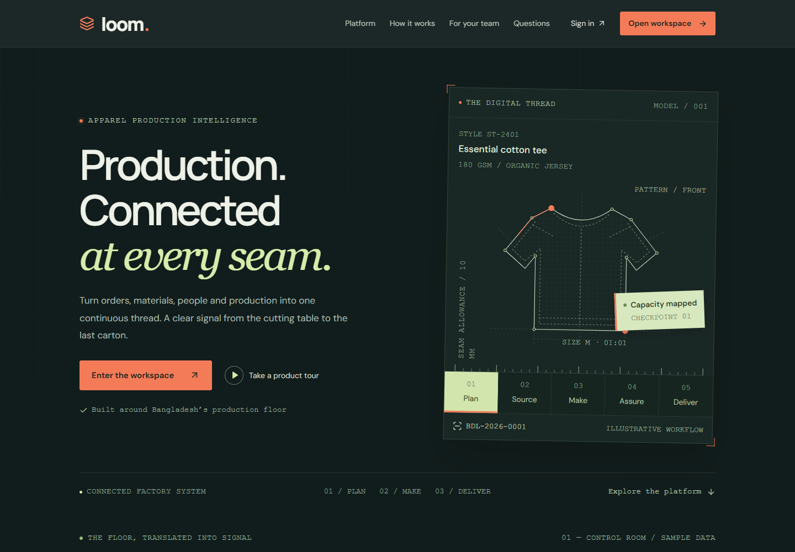

# Loom · Garments Production Workspace

A connected production floor for Bangladesh RMG factories: buyer orders → style/BOM → cutting → hourly sewing → QC/rework → finishing → packing → shipment, with operation-based worker payroll.



## Start locally

Requires Node.js **22.12+** (24 recommended) and Docker Desktop running Linux containers.

From the repository root (no root npm package is required):

```sh
npm --prefix backend ci
npm --prefix frontend ci
npm --prefix backend run setup
npm --prefix backend run dev:all
```

The root contains only `frontend/` and `backend/`, apart from Git's `.git` metadata. Each application has its own package, lockfile, configuration and dependencies. Scripts, Compose, docs, the original specification and CI template live inside `backend`; browser tests and public UI live inside `frontend`.

Open **http://localhost:3300** for the public landing page and **http://localhost:3300/workspace** for the application. API: `http://localhost:4400/api`. PostgreSQL/Redis use dedicated local ports **55432/56379**.

Setup creates ignored environment files if absent, generates a random JWT secret, starts persistent services, applies migrations, and seeds data. It preserves existing files/data and is safe to rerun.

Local accounts share `SEED_ADMIN_PASSWORD` from `backend/.env` (example: `ChangeMe123!`):

| Email                   | Role                  |
| ----------------------- | --------------------- |
| `admin@loom.local`      | Factory administrator |
| `accounts@loom.local`   | Accounts approver     |
| `supervisor@loom.local` | Supervisor · Line 01  |
| `qc@loom.local`         | Quality control       |

The seed includes one factory, four lines, a complete style/BOM/bulletin, three POs, twelve workers, production/QC/material records, and draft payroll. Use individual accounts and new secrets for deployment.

## Workspaces

The advanced suite adds a control tower, approval desk and **17 operational resources**. See [advanced workflows and rules](docs/advanced-suite.md) for the full feature map.

| Workspace         | Features                                                                                   |
| ----------------- | ------------------------------------------------------------------------------------------ |
| Overview          | Live output, hourly chart, weighted efficiency, shift targets, line cards, delivery alerts |
| Buyer orders      | Buyers, POs, color/size quantities, revisions, TNA and lifecycle                           |
| Style library     | BOM consumption/wastage, operation bulletin, SMV reconciliation                            |
| Planning          | Line/day allocation, targets, worker assignments and split hours                           |
| Cutting           | Basic lays, BOM shortage checks, release and completion                                    |
| Hourly production | Unique line/date/hour, size ratios, overtime, audited corrections                          |
| Quality           | Defect taxonomy, DHU, rejects, rework resolution                                           |
| Finishing/packing | Good-output constraints, color/size cartons and packing lists                              |
| Shipments         | Invoice references, destinations, packed/dispatch/delivered workflow                       |
| Materials         | Receipts, issues, returns and live BOM readiness                                           |
| Payroll           | Bulletin-derived poisha earnings, calculation, independent approval, CSV                   |
| People/settings   | Floors, lines, machines, workers, ten roles, line access, user activation                  |
| Reports           | Cumulative WIP, daily efficiency/DHU, CSV, before/after audit history                      |

UI text is **14px minimum**, with responsive layouts, keyboard navigation, focus-trapped dialogs, and reduced-motion support. `Ctrl/⌘ + K` opens module search.

## Production workflow

1. Create a draft style, BOM and operations. Operation SMV must sum to style SMV. Advance BOM ready → bulletin ready → active.
2. Add a PO and its color/size quantities; confirm and start production.
3. Receive/issue required materials. Plan, release and complete cutting lays.
4. Allocate the order to a line/date and enter hourly input/output. Use a specific size or `AUTO` to distribute totals by the order ratio for the selected color. Integer rounding reconciles exactly.
5. Inspect, reject or resolve rework; record good finishing output.
6. Create a shipment, add cartons, mark packed, then dispatch. Sealed cartons are locked.
7. Enter worker operation output, calculate payroll, and sign in as a **different** accounts user to approve/export.

Select table records to view, edit eligible fields, or advance status. Active BOM/bulletins are immutable; use a new style revision. Operational history is retained.

## Verification

Run these commands inside `backend`; `npm run verify:all` checks both projects, including database tests, builds and audits.

```sh
npm run typecheck
npm test
npm run build
npm audit --audit-level=moderate
```

To include PostgreSQL acceptance workflows (services must be running):

```powershell
$env:RUN_DB_TESTS='true'
npm test
```

On POSIX shells use `RUN_DB_TESTS=true npm test`. Tests provision and clean up only their own isolated factory.

With both app servers running:

```sh
npx playwright install chromium
npm run test:e2e
```

Run browser commands inside `frontend`. On Windows where downloaded binaries are restricted, use installed Edge: `$env:PLAYWRIGHT_CHANNEL='msedge'`. Run `npm run verify:all` inside `backend` to check both independent projects. The CI template is in `backend/ci/workflows/ci.yml`. Automatic GitHub discovery requires a root `.github/workflows` directory, which is intentionally absent under the requested two-folder layout; the template is available for a runner or future hosting configuration.

## Engineering

Next.js App Router + React, NestJS, Prisma 7/PostgreSQL 17, Redis 7/BullMQ, and authenticated Socket.IO. [Architecture/API](docs/architecture.md) · [Advanced suite](docs/advanced-suite.md) · [Deployment](docs/deployment.md) · [Original specification](docs/Project_spec.md).

PostgreSQL is authoritative. Tenant foreign keys, unique slots, checks and factory transaction locks protect writes; audits share the transaction. Redis stores nightly Dhaka-time report/bulletin caches. Live metrics and delivery risks derive from current records.

The release includes operation-based payroll, independent approvals, capacity scenarios, lot inventory, QR bundle passports, final sampling/CAPA, cost sheets, subcontract WIP, invoice/packing documents, resource tracking and an offline production outbox. It does not claim every capability of every commercial ERP/MES: CAD nesting, certified sampling tables, finance/GL, external customs/EDI/SMS/email, RFID hardware and external AI services are not connected. OEE and emissions are transparent estimates. Payroll calculation is synchronous. Lists load up to 10,000 rows/resource; larger deployments need server pagination and report projections.

Commits use the verified `amitavrchy` GitHub noreply identity and real dates. The original specification is preserved.
