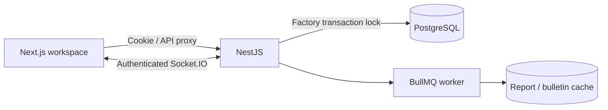

# Architecture & API

`frontend/src/lib` declares module forms and role controls. `backend/src/domain` validates input, references, lifecycle, WIP and payroll. Mutations run under a PostgreSQL factory advisory lock; tenant foreign keys, unique slots and checks provide additional integrity. The session determines factory/audit actor and the bulletin determines piece rates.

Use migrations rather than `db push`: custom SQL migrations contain tenant foreign keys and checks.

## API

All routes use `/api`. Writes require JSON and trusted origins. Login sets an eight-hour HttpOnly/SameSite=Strict cookie, Secure in production. Each request reloads the user so deactivation/role changes apply immediately. Supplement process-local login throttling with an ingress/shared limiter when scaling.

| Method         | Route                                                 | Purpose                         |
| -------------- | ----------------------------------------------------- | ------------------------------- |
| POST           | `/auth/login`                                         | `{email,password}`              |
| GET            | `/auth/me`                                            | Public current user             |
| POST           | `/auth/logout`                                        | Clear browser session           |
| GET            | `/health`                                             | API/PostgreSQL readiness        |
| GET / POST     | `/data/:resource`                                     | List / create                   |
| PATCH / DELETE | `/data/:resource/:id`                                 | Correct / delete eligible draft |
| POST           | `/data/:resource/:id/actions`                         | `{status}` transition           |
| POST           | `/data/qc/:id/actions`                                | `{action:"resolve",pcs}`        |
| POST           | `/data/users/:id/actions`                             | `{active:false}`                |
| POST           | `/production/hourly`                                  | Hourly output                   |
| GET            | `/production/efficiency?date=YYYY-MM-DD`              | Daily efficiency                |
| POST           | `/qc/inspections`                                     | QC entry                        |
| POST           | `/payroll/runs/:id/calculate`                         | Calculate run                   |
| GET            | `/reports/overview?date=YYYY-MM-DD`                   | Dashboard, alerts, WIP          |
| GET            | `/reports/wip`, `/reports/dhu`, `/reports/efficiency` | Production reports              |
| GET            | `/reports/materials/:orderId`                         | BOM readiness                   |
| GET            | `/reports/audit`                                      | Latest 300 factory audits       |
| GET            | `/reports/payroll/:id.csv`                            | Approved payroll CSV            |
| GET            | `/reports/packing/:id.csv`                            | Packing list                    |

Root CRUD aliases: `/buyers`, `/orders`, `/styles`, `/bom`, `/bulletin`, `/cutting`, `/packing`, `/shipments`. GET/POST operate on collections; PATCH/DELETE use `/:id`. They call the same services. Bulletin maps to operations; packing maps to cartons.

Resources: factories, floors, lines, machines, workers, users, buyers, styles, bom, operations, orders, quantities, milestones, assignments, allocations, materials, cutting, production, qc, finishing, shipments, cartons, pieceEntries, payroll.

Bodies follow `backend/src/domain/schemas.ts`. Writes return `{record,warnings}`. Invalid input returns 400, permissions 403, and duplicates/dependencies 409. Money uses integer poisha. Payroll CSV includes poisha and BDT.

## Invariants

- Completed cutting supplies sewing input; output cannot exceed input. `STRICT_WIP=false` converts cutting/input/output overshoots to warnings; finishing, packing and shipping always enforce constraints.
- Balances use order/color/size. AUTO entries persist an integer breakdown without duplicating line totals.
- Finishing excludes rejects/open rework. Cartons cannot exceed finishing. Dispatched/delivered cartons define shipped quantity.
- Efficiency uses weighted earned minutes / operator-minutes, including overtime. DHU counts defect occurrences. Cumulative inspected units cannot exceed output.
- Wastage uses basis points (`500 = 5%`). Full-order requirements must be issued before cutting release.
- Piece entries snapshot bulletin rates. Calculated payroll periods lock entries, cannot overlap, and require another accounts user for approval.
- Dates/reports/jobs use Asia/Dhaka; audit timestamps display in Dhaka.

Authenticated sockets join factory and assigned line rooms. Committed changes invalidate browser data; 30-second polling provides a fallback. Existing sockets receive metadata only; deactivated users cannot fetch data and leave rooms on reconnect.

BullMQ schedules midnight Dhaka aggregation with retries and caches reports/bulletins for 24 hours. Payroll runs synchronously in a transaction. Production counters remain in PostgreSQL to avoid cache-flush reconciliation loss.
